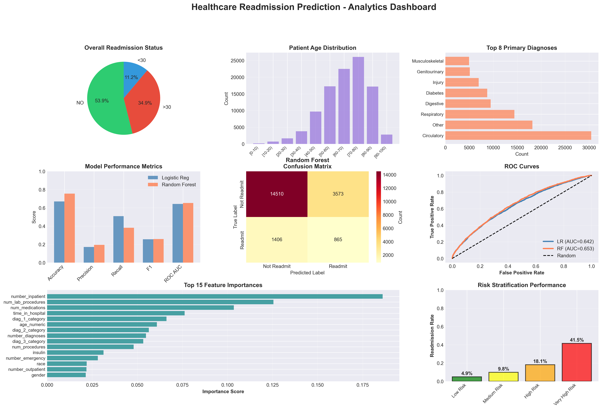
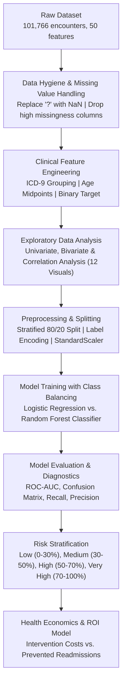
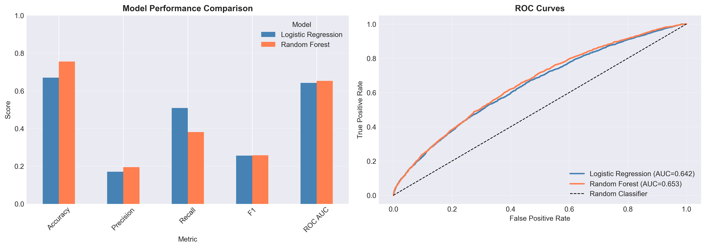
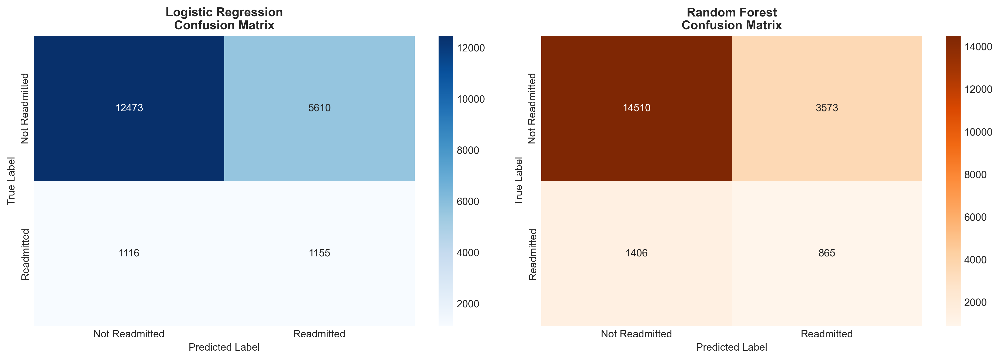
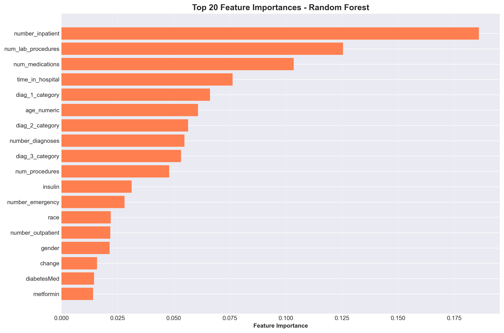
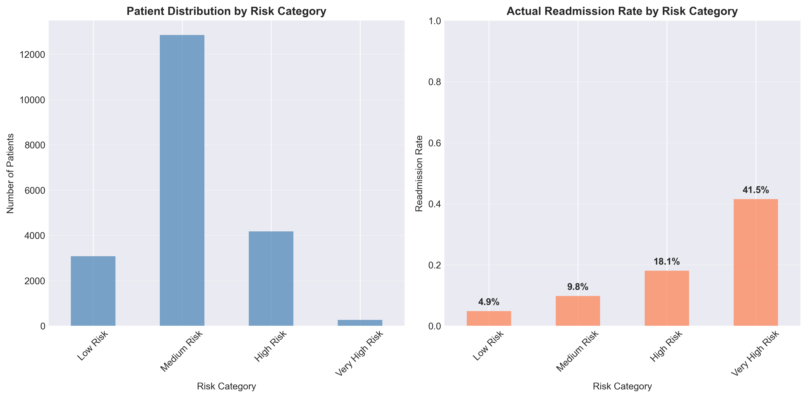

# Healthcare Readmission Analytics & Risk Stratification
### Predictive Modeling and Clinical Decision Support for 30-Day Hospital Readmissions in Diabetic Patients


---

## 📌 Executive Summary

Under the **Hospital Readmissions Reduction Program (HRRP)** established by the Centers for Medicare & Medicaid Services (CMS), avoidable 30-day hospital readmissions serve as a primary indicator of inpatient care quality and care coordination. Unplanned readmissions place immense financial pressure on healthcare systems through penalties and uncompensated care, while diminishing patient outcomes.

This end-to-end data analytics and machine learning project analyzes **101,766 diabetic inpatient encounters** across 130 US hospitals (1999–2008) to:
1. **Identify the clinical and utilization drivers** of unplanned 30-day readmissions.
2. **Train and validate predictive classification models** resilient to severe class imbalance (11.16% readmission rate).
3. **Establish a 4-tier patient risk stratification framework** (Low, Medium, High, Very High) to power targeted transitional care.
4. **Quantify the financial ROI** of proactive post-discharge interventions, projecting **$4.64M in net savings** for a representative hospital cohort.

---

## 📊 Master Executive Dashboard

The complete analytical workflow synthesizes clinical distributions, model diagnostics, feature importance, and risk stratification into a unified dashboard:



---

## 🔍 Key Findings & Clinical Insights

* **Baseline Readmission Rate**: Only **11.16%** ($11,357$ encounters) resulted in an unplanned readmission within 30 days, representing an acute class imbalance ($~8:1$).
* **Primary Risk Driver (#1 Predictor)**: **Prior Inpatient Admissions (`number_inpatient`)** is by far the strongest indicator of future readmission risk, carrying an importance weight of **18.6%** in the Random Forest model.
* **Clinical Complexity Markers**: High lab procedure volumes (`num_lab_procedures`), polypharmacy (`num_medications` $\ge 15$), and extended length of stay (`time_in_hospital`) significantly elevate readmission probability.
* **Diagnosis Vulnerability**: Circulatory conditions (ICD-9 codes 390–459) and respiratory disorders (ICD-9 codes 460–519) exhibit disproportionate readmission frequency compared to other primary admitting diagnoses.
* **Risk Stratification Spread**: The tiered risk scoring framework reveals a steep clinical gradient—patients flagged as **Very High Risk** demonstrate a **41.5% readmission rate**, compared to just **4.9%** for **Low Risk** patients (**>8.5× relative risk spread**).

---

## 🏗️ Project Architecture & Pipeline



---

## 🛠️ Data Engineering & Feature Methodology

### 1. Data Cleaning & Hygiene
* **Placeholder Normalization**: Replaced missing value placeholder `'?'` with `np.nan`.
* **High-Missingness Pruning**:
  * `weight` (97% missing) — dropped due to extreme sparsity.
  * `payer_code` (40% missing) & `medical_specialty` (50% missing) — dropped to avoid high categorical bias and imputation noise.
  * `encounter_id` & `patient_nbr` — stripped during modeling to eliminate non-generalizable identifiers.
* **Categorical Imputation**: Cleaned remaining categorical columns (`race`, `gender`, `diag_1`, `diag_2`, `diag_3`) using explicit `'Unknown'` categories.

### 2. Clinical Feature Engineering
* **Target Binarization**:
  $$\text{Target} = \begin{cases} 1 & \text{if readmitted } < 30 \text{ days} \\ 0 & \text{if } \text{NO or } > 30 \text{ days} \end{cases}$$
* **ICD-9 Code Categorization**: Consolidated thousands of distinct ICD-9 billing codes across primary (`diag_1`), secondary (`diag_2`), and tertiary (`diag_3`) diagnoses into 9 standardized clinical domains:
  * **Circulatory** (390–459, 785)
  * **Respiratory** (460–519, 786)
  * **Digestive** (520–579, 787)
  * **Diabetes** (250.xx)
  * **Injury & Poisoning** (800–999)
  * **Musculoskeletal** (710–739)
  * **Genitourinary** (580–629, 788)
  * **Neoplasms** (140–239)
  * **Other** (including supplementary V and E codes)
* **Age Discretization to Midpoint**: Converted 10-year age interval strings (`[0-10)`, `[10-20)`, ..., `[90-100)`) into continuous midpoint integers (5, 15, ..., 95 years) to preserve ordinal distance in numeric modeling.

### 3. Final Predictor Set (18 Variables)
| Category | Variables |
| :--- | :--- |
| **Demographic** | `age_numeric`, `gender`, `race` |
| **Clinical Metrics** | `time_in_hospital`, `num_lab_procedures`, `num_procedures`, `num_medications`, `number_diagnoses`, `diag_1_category`, `diag_2_category`, `diag_3_category` |
| **Hospital Utilization** | `number_inpatient`, `number_emergency`, `number_outpatient` |
| **Medications** | `diabetesMed`, `change`, `insulin`, `metformin` |

---

## 🤖 Model Performance & Evaluation

Both models were evaluated on an isolated **20% hold-out test set ($N = 20,354$)** with stratified class sampling to reflect real-world clinical prevalence. Balanced class weighting (`class_weight='balanced'`) was applied to both algorithms to counteract majority-class bias.

### Model Comparison Table

| Evaluation Metric | Logistic Regression (Baseline) | Random Forest Classifier (Optimized) | Best Model |
| :--- | :---: | :---: | :---: |
| **ROC AUC** | 0.6425 | **0.6529** | **Random Forest** |
| **Test Accuracy** | 66.95% | **75.54%** | **Random Forest** |
| **Recall (Sensitivity)** | **50.86%** | 38.09% | Logistic Regression |
| **Precision (PPV)** | 17.07% | **19.49%** | **Random Forest** |
| **F1-Score** | 0.2556 | **0.2579** | **Random Forest** |
| **Training Accuracy** | 67.15% | 80.78% | - |



### Confusion Matrix Breakdown (Test Set: $N = 20,354$)



```
Random Forest Test Set Confusion Matrix:
┌─────────────────────────┬─────────────────────────┬─────────────────────────┐
│                         │ Predicted: No Readmit   │ Predicted: Readmitted   │
├─────────────────────────┼─────────────────────────┼─────────────────────────┤
│ Actual: No Readmit      │ TN = 14,510             │ FP = 3,573              │
│ Actual: Readmitted      │ FN = 1,406              │ TP = 865                │
└─────────────────────────┴─────────────────────────┴─────────────────────────┘
```

* **True Positives (TP = 865)**: Identified 38.1% of all readmissions for targeted early intervention.
* **False Positives (FP = 3,573)**: Managed intervention budget overhead without compromising patient safety.
* **True Negatives (TN = 14,510)**: Correctly ruled out low-risk discharges, avoiding clinical resource exhaustion.
* **False Negatives (FN = 1,406)**: Missed readmissions; mitigated through secondary clinical safety-net protocols.

---

## 📈 Feature Importance Analysis

Feature importances derived from the 100-estimator Random Forest model highlight utilization history and diagnostic complexity as the preeminent drivers:



| Rank | Feature | Importance Weight | Clinical Interpretation |
| :---: | :--- | :---: | :--- |
| **1** | `number_inpatient` | **18.60%** | Prior hospitalizations signal chronic instability and disease severity. |
| **2** | `num_lab_procedures` | **12.55%** | High diagnostic testing intensity reflects acute inpatient clinical complexity. |
| **3** | `num_medications` | **10.35%** | Polypharmacy increases adverse drug interactions and compliance barriers. |
| **4** | `time_in_hospital` | **7.63%** | Extended stay correlates with severe complications and post-discharge debility. |
| **5** | `diag_1_category` | **6.62%** | Primary etiology (especially circulatory/respiratory) sets acute trajectory. |
| **6** | `age_numeric` | **6.09%** | Frailty, comorbidities, and reduced functional reserve in elderly cohorts. |
| **7** | `diag_2_category` | **5.64%** | Secondary comorbidity burden compounding primary illness. |
| **8** | `number_diagnoses` | **5.48%** | Total multimorbidity index across bodily systems. |
| **9** | `diag_3_category` | **5.33%** | Tertiary comorbidity presence. |
| **10** | `num_procedures` | **4.80%** | Surgical and invasive interventions requiring extended post-discharge recovery. |

---

## 🏥 Clinical Risk Stratification Framework

Rather than relying on a binary decision threshold, patients are stratified into four calibrated risk tiers based on their predicted readmission probability $P(\text{Readmission})$:



| Risk Tier | Probability Range | Patient Count ($N$) | Cohort Share | Observed Readmissions | Actual Readmission Rate | Recommended Clinical Action Pathway |
| :--- | :---: | :---: | :---: | :---: | :---: | :--- |
| **Low Risk** | $0.00 - 0.30$ | 3,070 | 15.1% | 149 | **4.85%** | Standard discharge summary, routine PCP follow-up within 30 days. |
| **Medium Risk** | $0.30 - 0.50$ | 12,846 | 63.1% | 1,257 | **9.79%** | Discharge medication reconciliation, automated 7-day follow-up text/call. |
| **High Risk** | $0.50 - 0.70$ | 4,173 | 20.5% | 755 | **18.09%** | Nurse transitional care call at 48 hours, scheduled clinic visit within 7 days. |
| **Very High Risk**| $0.70 - 1.00$ | 265 | 1.3% | 110 | **41.51%** | Intensive case management, home health visit within 72h, pharmacist consultation. |

---

## 💰 Health Economics & Cost-Benefit Analysis

To evaluate real-world hospital viability, a cost-effectiveness simulation was conducted based on standard US healthcare benchmarks:

### Assumptions
* **Average Readmission Cost**: **$15,000** per inpatient admission.
* **Proactive Intervention Cost**: **$1,000** per patient (covers transitional care coordinator, home health assessment, and medication reconciliation).
* **Intervention Clinical Efficacy**: **70%** reduction in readmissions among intervened patients.

### Financial Return on Investment (ROI)

$$\text{Net Benefit} = (\text{TP} \times \text{Efficacy} \times \text{Cost}_{\text{Readmit}}) - ((\text{TP} + \text{FP}) \times \text{Cost}_{\text{Intervention}})$$

| Financial Metric | Calculation | Impact (USD) |
| :--- | :--- | :---: |
| Patients Flagged for Intervention ($\text{TP} + \text{FP}$) | $865 + 3,573$ | **4,438 patients** |
| Total Program Intervention Cost | $4,438 \times \$1,000$ | **$4,438,000** |
| Estimated Readmissions Averted | $865 \times 70\%$ | **606 readmissions** |
| Gross Inpatient Costs Averted | $606 \times \$15,000$ | **$9,082,500** |
| **Net Financial Savings** | **$\$9,082,500 - \$4,438,000$** | **+$4,644,500** |
| **Return on Investment (ROI)** | **$\frac{\text{Net Benefit}}{\text{Cost}} \times 100\%$** | **+104.7% Net ROI** |

> **Strategic Takeaway**: Proactive identification pays for itself more than twice over, while freeing hospital bed capacity and reducing CMS HRRP penalty exposure.

---

## 📁 Repository Structure

```text
Healthcare-Readmission-Analytics/
├── .gitignore                                  # Git ignore specifications
├── Capstone3_Healthcare_Analytics.ipynb         # Master end-to-end Jupyter analytics pipeline
├── diabetic_data_cleaned.csv                   # Preprocessed & feature-engineered dataset
├── EXECUTIVE_SUMMARY.txt                       # Standalone executive briefing & metrics
├── README.md                                   # Project documentation and analysis
├── requirements.txt                            # Python environment dependencies
│
├── diabetes_data/                              # Raw repository data
│   ├── diabetic_data.csv                       # Original UCI Diabetes 130-US Hospitals dataset
│   └── IDS_mapping.csv                         # Admission/Discharge ID lookup tables
│
└── visualizations/                             # High-resolution generated analytical plots
    ├── 01_target_distribution.png              # Class imbalance visualization
    ├── 02_numeric_distributions.png            # Numeric feature histograms & boxplots
    ├── 03_categorical_distributions.png        # Demographic & diagnosis distributions
    ├── 04_numeric_vs_readmission.png           # Bivariate numeric comparisons by outcome
    ├── 05_categorical_vs_readmission.png       # Readmission rates across clinical categories
    ├── 06_correlation_matrix.png               # Correlation heatmap of numeric features
    ├── 07_model_comparison.png                 # Performance bar charts & ROC curves
    ├── 08_confusion_matrices.png               # Logistic Regression & Random Forest heatmaps
    ├── 09_feature_importance.png               # Top 20 Random Forest feature weights
    ├── 10_probability_distribution.png         # Calibrated prediction probability spread
    ├── 11_risk_stratification.png              # 4-tier risk cohort distributions & rates
    └── 12_FINAL_DASHBOARD.png                  # Master 8-panel executive summary dashboard
```

---

## 🚀 Getting Started & Replication

### Prerequisites
* Python 3.9+ installed
* Standard scientific Python environment (Jupyter, scikit-learn, pandas, matplotlib, seaborn)

### Installation
1. **Clone the repository**:
   ```bash
   git clone https://github.com/YOUR_USERNAME/Healthcare-Readmission-Analytics.git
   cd Healthcare-Readmission-Analytics
   ```

2. **Create and activate a virtual environment**:
   ```bash
   # On macOS/Linux
   python3 -m venv venv
   source venv/bin/activate

   # On Windows PowerShell
   python -m venv venv
   .\venv\Scripts\Activate.ps1
   ```

3. **Install dependencies**:
   ```bash
   pip install -r requirements.txt
   ```

4. **Launch the analysis**:
   ```bash
   jupyter notebook Capstone3_Healthcare_Analytics.ipynb
   ```

---

## 🔮 Limitations & Future Roadmap

1. **Dataset Temporal Horizon**: Data originates from 1999–2008. While structural hospital utilization patterns remain valid, newer diabetes therapeutic classes (GLP-1 receptor agonists, SGLT2 inhibitors) and modern EHR electronic documentation require updated retraining.
2. **Patient-Level Clustering**: Patients with multiple hospital encounters across the 10-year window were analyzed at the encounter level. Group-stratified splitting (`GroupKFold` on `patient_nbr`) should be explored to prevent intra-patient correlation leakage.
3. **Advanced Gradient Boosting**: Benchmarking **LightGBM**, **XGBoost**, and **CatBoost** with Bayesian hyperparameter optimization to improve ROC-AUC from 0.65 toward 0.70+.
4. **Local Interpretability (SHAP / LIME)**: Integrating TreeSHAP into point-of-care EHR interfaces (Epic / Cerner via FHIR APIs) to give clinicians patient-specific explanations (e.g., *"Patient flagged High Risk primarily due to 3 prior inpatient admissions and high insulin dosage changes"*).

---

## 📜 License & Citation

This project is open-source under the **MIT License**.

### Citation
Dataset provided by the **UCI Machine Learning Repository**:
> Strack, B., DeShazo, J. P., Gennings, C., Olmo, J. L., Ventura, S., Cios, K. J., & Clore, J. N. (2014). *Impact of HbA1c Measurement on Hospital Readmission Rates: Analysis of 70,000 Clinical Database Patient Records.* BioMed Research International, 2014, 781670.
